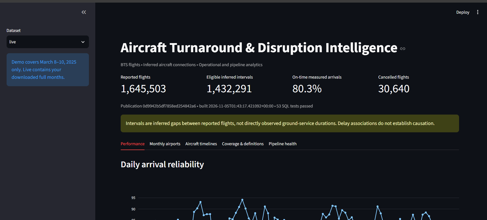

# Aircraft Turnaround & Disruption Intelligence

A Python data pipeline that analyzes historical U.S. airline flight delays, cancellations, and inferred gaps between flights operated by the same aircraft.

**Tools:** Python, DuckDB, Parquet, PostgreSQL, dbt/SQL, Docker, Streamlit. Airflow is optional.

## Results (January–March 2025)

| Measure | Result |
|---|---:|
| Reported flights processed | 1,645,503 |
| On-time measured arrivals | 80.3% |
| Canceled flights | 30,640 |
| Eligible inferred aircraft intervals | 1,432,291 |
| dbt data tests | 53 passed |



Data: [U.S. BTS Reporting Carrier On-Time Performance](https://www.transtats.bts.gov/DL_SelectFields.aspx?QO_fu146_anzr=b0-gvzr&gnoyr_VQ=FGJ). This is historical data from qualifying reporting airlines, not all U.S. flights. An *inferred interval* is a gap between reported legs, **not** directly measured ground servicing time. See the [findings and limitations](docs/FINDINGS.md).

## What happens

```text
BTS flight ZIPs → Python validation → Parquet/DuckDB → PostgreSQL → dbt checks → dashboard
```

The same pipeline can run directly through Docker or through a nine-task Airflow DAG. The full January–March run was completed via Docker CLI; **Airflow was separately verified on the smaller demo**, not on the full-quarter run.

## Run it locally (Windows)

Requires [Docker Desktop](https://docs.docker.com/desktop/setup/install/windows-install/) with [WSL 2](https://learn.microsoft.com/windows/wsl/install) and Linux containers. Open Docker Desktop, then open PowerShell in this folder:

```powershell
Set-ExecutionPolicy -Scope Process Bypass
.\scripts\setup.ps1 -Profile lite
.\scripts\run-demo.ps1
```

Open <http://localhost:8501> and select **Demo** (58,357 flights from March 8–10, 2025). For the full three-month dataset, run:

```powershell
docker compose --profile tools run --rm pipeline run --mode live --start 2025-01 --end 2025-03
```

Select **Live** in the dashboard. For Airflow, run `.\scripts\setup.ps1 -Profile full` and visit <http://localhost:8080> (password is stored locally in `.env`; never publish it).

To stop the running services *without erasing saved data*:

```powershell
docker compose --profile full stop
```

To restart the basic services, use `docker compose up -d --wait`. For checks or troubleshooting, see [operations](docs/OPERATIONS.md). Do **not** use `docker compose down -v` unless you intend to erase project volumes.

## Verification

The full-quarter Docker run completed warehouse loading, 53 passing dbt tests and dashboard publication. A separate demo Airflow run completed 9/9 tasks. Local Python checks: 55 passed, 6 skipped. GitHub Actions CI is **not yet verified**. See [local verification](docs/LOCAL_VERIFICATION.md).

The original notebook remains under `notebooks/legacy/`. [Metric definitions](docs/METRICS.md), [data dictionary](docs/DATA_DICTIONARY.md), and [data/third-party notices](DATA_NOTICE.md) are included for reference.
