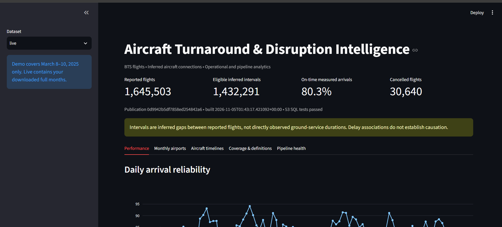

# Flight findings — January–March 2025

**Source:** [U.S. Bureau of Transportation Statistics — Reporting Carrier On-Time Performance](https://www.transtats.bts.gov/DL_SelectFields.aspx?QO_fu146_anzr=b0-gvzr&gnoyr_VQ=FGJ). These are historical reports from qualifying airlines, not live aircraft tracking.

## Full three-month dataset

| Measure | Result |
|---|---:|
| Reported flights | **1,645,503** |
| On-time measured arrivals | **80.3%** |
| Cancellations | **30,640** |
| Eligible inferred aircraft intervals | **1,432,291** |
| Data-quality checks | **53 dbt tests passed** |

**What stands out:** Roughly four in five flights with a usable arrival measurement were on time under the project's definition (less than 15 minutes late). Cancellations are counted separately; they don't have an ordinary arrival-delay measurement. The platform inferred aircraft connections to explore turnaround patterns, but those intervals aren't direct measurements of ground-crew activity and don't prove why a delay happened.

The three-month pipeline was completed locally using the Docker CLI with PostgreSQL, dbt and published dashboard results. The nine-task Airflow DAG was tested successfully on the **separate three-day demo**, not the full historical run.

## Reproducible demo

The included March 8–10, 2025 sample has **58,357 flights**. Its measured on-time arrival rate was **82.1%**, with **218 cancellations**, **89 diversions**, and **49,662 eligible inferred intervals**.

The three daily on-time rates were **81.9%**, **80.4%**, and **83.9%**, respectively. Three days aren't enough to establish a seasonal or causal pattern.

## Limitations

- The coverage is **January–March 2025**, not a full-year or all-aircraft study.
- Missing tail numbers, unreported repositioning flights, diversions and timestamp limitations can affect inferred aircraft sequences.
- The 80.3% figure uses flights with measured arrivals; it is **not** a share of all scheduled flights.
- The full-quarter dashboard was observed locally; its subgroup comparisons and exact measured-arrival denominator weren't independently recomputed for this report.
- GitHub-hosted CI, cloud deployment and a full-quarter Airflow-controlled run have not been verified. See [local checks](LOCAL_VERIFICATION.md).
