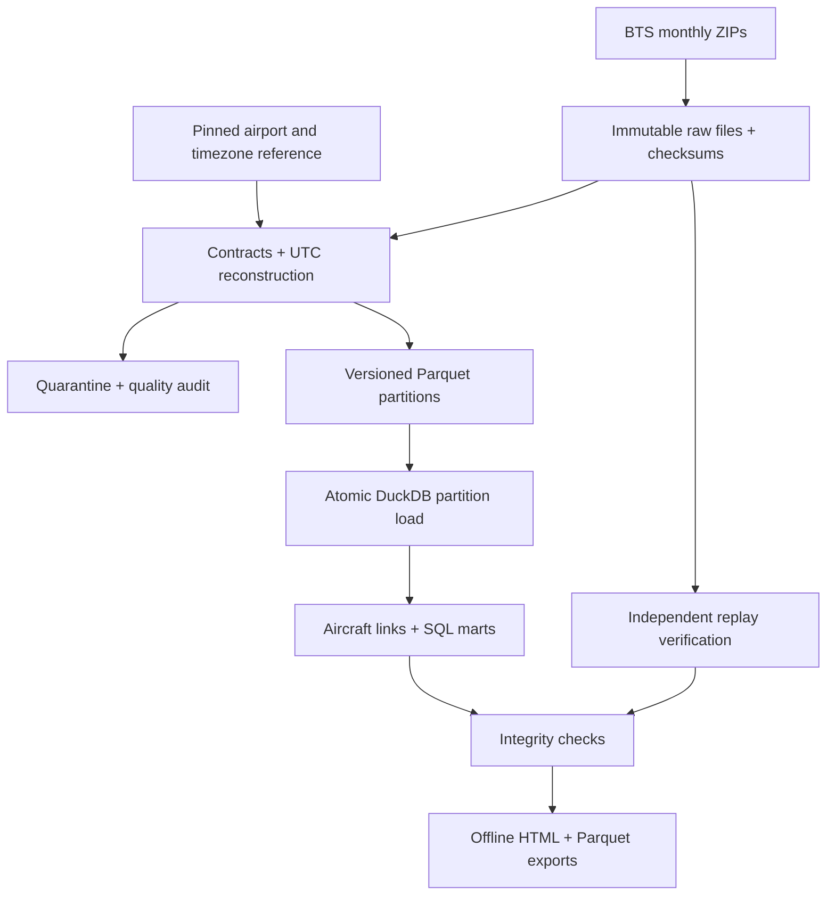

# Aircraft Turnaround & Disruption Data Platform

An end-to-end batch data platform that reconstructs successive aircraft movements from U.S. reporting-carrier flight records. It produces a reproducible warehouse, a turnaround dataset, and an interactive operations report.

## Run in Google Colab

Upload `Aircraft_Turnaround_Data_Platform.ipynb`, choose a standard CPU runtime, and use **Runtime → Run all**. The notebook contains the complete project source and a real-data demo. No API key or paid service is required. Google Drive mounting is optional.

- `DATA_MODE="live"` downloads the complete January–March 2025 reporting-carrier archives, approximately 79 MiB compressed. The verified source contains 1,645,503 flights. Processing needs a few GB of disk and can take several minutes.
- `DATA_MODE="demo"` uses 58,357 real records for March 8–10, 2025, embedded in the notebook. This includes the U.S. spring daylight-saving transition. It is a curated slice, clearly labeled in all outputs.
- Modes use separate runtime folders. There is no automatic switch to sample or invented data if a source is unavailable.
- `MONTHS` controls which partitions are ingested. Previously loaded months stay in the warehouse and report. Use a new runtime directory for a different isolated cohort.
- `REFRESH_SOURCE=True` downloads requested months again and detects provider revisions by checksum. With `False`, verified local raw files are reused and only missing months are fetched.

The notebook writes a results ZIP. An optional full checkpoint includes raw files, silver versions, and the database. A Drive checkpoint is copied only after all database connections close; the active database stays on local disk. Without a saved checkpoint, a Colab reset loses the runtime state, and Run all rebuilds it.

## What the project answers

1. Which airports and dates had poor arrival/departure reliability in the selected historical period?
2. How much gate time separated successive eligible legs of the same aircraft?
3. When an inbound aircraft arrived at least 15 minutes late, how often was the next linked departure also late?
4. Where did delay minutes shrink or grow during a turnaround?
5. Which records could not support a reliable link, and why?

The report is operational analysis of historical records. It is not a causal model, a live flight tracker, a dispatch system, or a turnaround safety recommendation.

## Architecture



## Local commands

Python 3.12 is the verified environment.

```bash
pip install -r requirements.txt
python -m pytest -q
python run_pipeline.py --root runtime_live
python run_pipeline.py --root runtime_demo --mode demo
python run_pipeline.py --root runtime_live --months 2025-04
python run_pipeline.py --root runtime_live --months 2025-03 --refresh
python run_pipeline.py --root rebuilt --replay-root runtime_live
```

The final command reconstructs the default three-month cohort from saved raw files. Pass `--months` when the source has a different set of months. A separate empty target is required for the notebook's independent verification.

Docker and GitHub Actions files are provided for portability. They are scaffolding until you run them in those environments. Example Docker usage:

```bash
docker build -t aircraft-platform .
docker run --rm -v "$PWD/data:/data" aircraft-platform --root /data/runtime --mode demo
```

## Data contracts and time reconstruction

The source is the **reporting-carrier** dataset, so marketing-carrier codeshares are not combined into duplicate movements. The business key is flight date, DOT carrier ID, reporting flight number, origin and destination BTS airport IDs, and scheduled departure HHMM. Tail number is not in the key because it can be corrected.

Missing required columns fail the partition. New columns remain in raw storage but are not automatically added to the curated schema. Invalid essential keys, flags, nonfinite numeric values, or negative durations/distances are quarantined. Identical business records are collapsed; conflicting rows with the same business key are quarantined together. More than 1% rejected rows, or no accepted rows, fails the partition.

UTC reconstruction uses the pinned IANA timezone rules:

```text
scheduled departure UTC = FlightDate + origin local scheduled HHMM, localized
scheduled arrival UTC = scheduled departure UTC + scheduled elapsed minutes
actual departure UTC = scheduled departure UTC + reported departure delay
actual arrival UTC = actual departure UTC + reported actual elapsed minutes
```

The inferred arrival and departure clocks are checked in the respective airport timezones against the original fields. Computed arrival delay must agree within one minute. This handles overnight and multi-day delays without guessing the actual date from an HHMM clock. `2400` means midnight of the following day. Ambiguous fall-back and nonexistent spring-forward local scheduled times remain unresolved.

Cancelled and diverted records stay in the warehouse and reliability denominators as documented. Their ordinary arrival fields are not used to fabricate complete trips. Other invalid clocks stay visible but cannot form eligible turnarounds.

## Aircraft linking and metric definitions

All assigned records are ordered by scheduled departure before filtering. A cancellation, diversion, missing clock or other problematic leg can break a chain. Candidate pairs require:

- Matching tail number and reported carrier; inbound destination equals outbound origin.
- Both legs completed without diversion and with validated times.
- Nonnegative scheduled and actual gaps, each at most 720 minutes by default.
- No overlap with the latest prior actual arrival in the aircraft's ordered history.
- No unorderable scheduled record on either linked flight date.

This conservative linkage describes adjacent **reported** legs. It cannot observe ferry, maintenance, international or unreported movements; matching endpoints do not prove uninterrupted ground time. Sorting by actual departure would silently rearrange the planned sequence, so schedule reversals and overlaps are excluded rather than repaired speculatively.

`actual_turn_min = outbound actual departure − inbound actual arrival`

`planned_turn_min = outbound scheduled departure − inbound scheduled arrival`

`recovered_delay_min = inbound arrival delay − outbound departure delay`

The identity `actual turn − planned turn = outbound delay − inbound delay` is tested. Positive recovery means delay minutes decreased; negative recovery means they increased. Conditional late-outbound rates use eligible pairs with inbound delay >=15 minutes. Wilson intervals describe sampling uncertainty for that observed proportion, not causal confidence. Airport/turn-band groups differ in carriers, routes, weather and operating conditions.

Arrival on-time rate uses completed, non-diverted flights with a reported arrival delay as its denominator. Cancellations use all scheduled records. Departure lateness uses non-cancelled records with departure delay, including flights later diverted. Missing measures remain missing. Reported delay-cause minutes are preserved separately and do not label the reconstructed pair as causal.

## Reliability and recovery

One writer holds an OS file lock. Source ZIPs are streamed with bounded retries, a timeout, an HTTP-size cap, and ZIP structure checks. A 404 or schema error fails clearly. Downloads are promoted from partial files only after ZIP validation.

Normalization streams the source in 100,000-row chunks. SQL resolves duplicates across chunk boundaries. Each month commits its current flights, checkpoint, source-version metadata, activation history, source changes and quality checks in one transaction. Other committed months survive a later failure. Raw, staging and silver files live outside that SQL transaction; failed work can remain for diagnosis and is safely rebuilt on retry.

Each source/reference/transform combination gets a deterministic version ID. Raw bytes and historical silver partitions are retained. Source updates replace the whole month, recording insert/update/withdrawal counts. A provider change to a business-key field appears as withdrawal plus insertion. `partition_activations` records each activation, including reactivation of an older snapshot. Selected changed values are in `flight_changes`; complete old/new records are in versioned Parquet.

Replaying an unchanged active partition performs no business insert. Rebuild verification independently recreates nine business tables from raw files and compares every row with `EXCEPT ALL` in both directions, then repeats replay to check idempotence.

## Outputs and project layout

- `aircraft_core.py`: configuration, locking, source identity, reference capture.
- `aircraft_transform.py`: contracts, normalization, timezone/clock validation.
- `aircraft_ingest.py`: downloads, chunked processing, quarantine, transaction and change capture.
- `sql/models.sql`: dimensions, flight-pair model, analytical marts.
- `aircraft_models.py`: model orchestration and warehouse invariants.
- `aircraft_report.py` + `assets/report.html`: portable interactive report and exports.
- `run_pipeline.py`: notebook/CLI shared entry point and failure audit.
- `verify_rebuild.py`: exact independent reconstruction check.
- `workspace_tools.py`: result bundles and safe full checkpoints.
- `tests/`: deterministic isolated fixtures for edge cases and failure recovery.
- `demo/`: attributed real BTS slice, with its original archive checksum.

Runtime folders: `bronze/`, `silver/`, `quarantine/`, `reference/`, `gold/`, `logs/`; plus `warehouse.duckdb`. A `gold/latest.json` pointer identifies the last successfully published report. Publications have unique directories so a failed later publication leaves the earlier one available. Audit exports describe the state before their own publication completes.

## Portfolio explanation

Suggested resume wording after running and understanding the notebook:

> Built a reproducible aircraft-operations pipeline for 1.65 million BTS flight records using Python, SQL, Parquet and DuckDB; implemented atomic monthly loads, source revision tracking, timezone validation, and recovery tests, and reconstructed 1.43 million eligible aircraft turnarounds.

The counts describe the verified January–March 2025 source snapshot and default 12-hour window. Use your own run's values if you change the cohort. Do not claim reductions in airline delays, production deployment, Airflow/Kafka experience, or causal prediction from this project.

See `DATA_DICTIONARY.md`, `DATA_NOTICE.md`, and the delivered `VERIFICATION.md` for exact scope and evidence.
